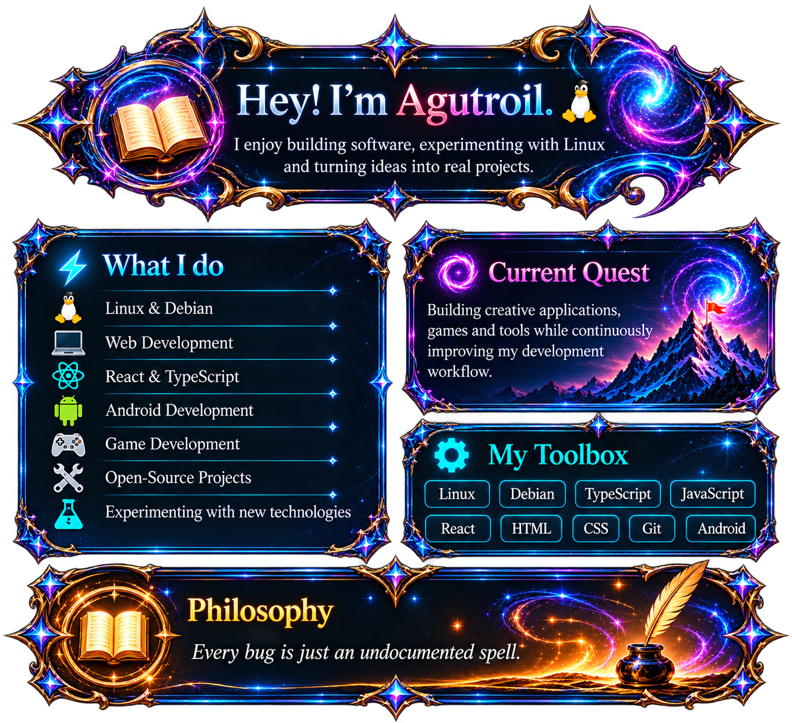
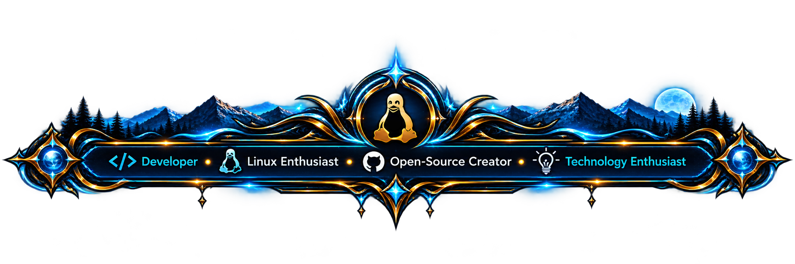
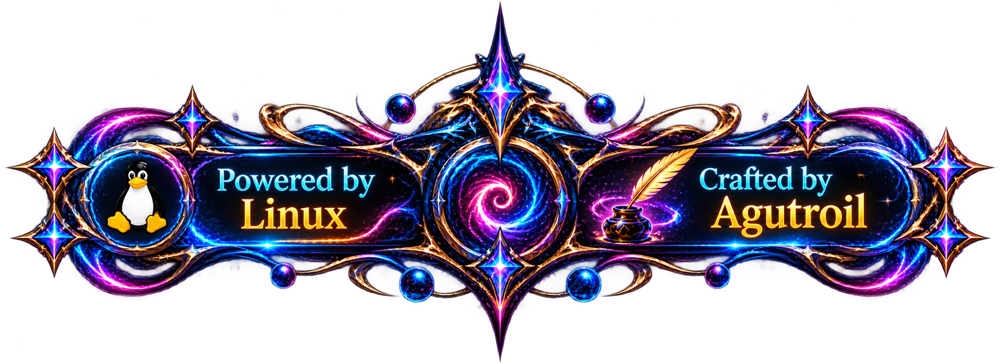

  

<h1 align="center">👋 Anton Deister</h1>

  <strong>Developer · Linux Enthusiast · Open-Source Creator · Technology Enthusiast</strong>

  <a href="https://github.com/Agutroil">
    <strong>GitHub @Agutroil</strong>
  </a>

---

<table>
<tr>
<td width="68%" valign="top">

## 👋 Über mich

Hallo, ich bin **Anton Deister** – auf GitHub unterwegs als **Agutroil**.

Ich beschäftige mich leidenschaftlich mit **Softwareentwicklung, Linux, Open Source und Game Development**.

Besonders spannend finde ich Projekte, bei denen aus einer Idee Schritt für Schritt etwas Eigenes entsteht – egal ob Anwendung, Spiel, Entwicklungswerkzeug oder Experiment.

Ich arbeite gerne mit neuen Technologien, automatisiere Entwicklungsabläufe und beschäftige mich zunehmend mit **KI-gestützten Developer-Workflows**.

### 🐧 Was mich besonders interessiert

- Linux & Debian
- Software Development
- Open Source
- Game Development
- Godot
- Web Development
- React & TypeScript
- Python
- Android Development
- Automatisierung
- KI-gestützte Entwicklung

</td>

<td width="32%" align="center" valign="top">

 

<strong>Anton Deister</strong>

Developer · Agutroil

</td>
</tr>
</table>

---

  

---

## 🚀 Was ich mache

Ich arbeite an eigenen Projekten aus verschiedenen Bereichen und probiere dabei gerne neue Technologien und Entwicklungsansätze aus.

### 🎮 Game Development

Eigene Spiele, Game-Systeme und technische Experimente mit **Godot**.

Mich interessieren dabei besonders:

- World Building
- Gameplay-Systeme
- Multiplayer
- Game Architecture
- Performance
- Tools für Entwickler

### 🌐 Web Development

Entwicklung und Experimente mit:

`React` · `TypeScript` · `JavaScript` · `HTML` · `CSS`

### 🐧 Linux

Linux ist ein zentraler Bestandteil meiner Entwicklungsumgebung.

Mein Schwerpunkt liegt besonders auf:

`Debian` · `Terminal Workflows` · `Git` · `Automation` · `Development Tools`

### 🤖 AI-assisted Development

Ich beschäftige mich mit der Frage, wie KI-Agenten sinnvoll in reale Entwicklungsprojekte integriert werden können.

Dabei interessieren mich insbesondere:

- Coding Agents
- automatisierte Tests
- AI Tool Bridges
- Asset Pipelines
- automatisierte Workflows
- reproduzierbare Entwicklungsprozesse

---

## 🧰 Meine Toolbox

`Linux` · `Debian` · `Godot` · `GDScript` · `Git` · `GitHub`

`Python` · `TypeScript` · `JavaScript` · `React`

`HTML` · `CSS` · `Android` · `Shell`

---

## 🧙 Agutroil

**Agutroil** ist mein Name für meine Projekte und meine Entwickleridentität auf GitHub.

Der Name verbindet für mich:

**Code · Linux · Games · Open Source · Ideen · Experimentieren**

  

---

## 🛠️ Projekte

### 🌌 Nythara

Ein Fantasy-Game-Projekt auf Basis von **Godot**, an dem ich aktuell aktiv arbeite.

Schwerpunkte sind unter anderem:

- große Spielwelten
- Multiplayer
- World Building
- Combat
- Portale und Regionen
- Monster und Bosse
- Items und Equipment
- Developer Tools

> Nythara befindet sich noch aktiv in Entwicklung.

---

### 🏰 Astra Kingdom

Ein weiteres eigenes Game-Projekt, das sich mit Progression, Combat und umfangreichen Spielsystemen beschäftigt.

---

## 🔬 Aktuell beschäftige ich mich mit

- größeren Godot-Spielwelten
- Multiplayer-Architektur
- Linux-basierten Entwicklungsumgebungen
- automatisierten Asset-Pipelines
- Coding Agents
- KI-gestützten Entwicklungswerkzeugen
- Performance auf schwächerer Hardware
- Open-Source-Workflows

---

## 💭 Philosophie

> **Every bug is just an undocumented spell.**

Ich mag Projekte, bei denen Experimentieren ausdrücklich dazugehört.

Nicht jede Idee muss sofort perfekt sein.

Wichtig ist für mich:

**bauen → testen → verstehen → verbessern → teilen**

  

---

## 🔗 Links

<a href="https://github.com/Agutroil">
  <strong>🐙 GitHub</strong>
</a>

&nbsp;&nbsp;•&nbsp;&nbsp;

<a href="https://github.com/Agutroil/Nythara">
  <strong>🎮 Nythara</strong>
</a>

---

  

  

  🐧 Powered by Linux · 🪄 Crafted by Agutroil

