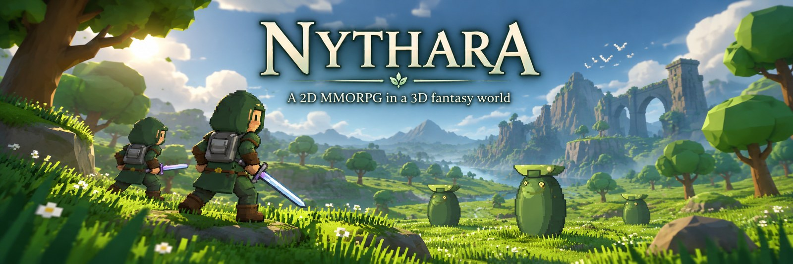

<!--
=============================================================================
  AGUTROIL · GITHUB PROFILE README
  Anton Deister / Agutroil
=============================================================================
-->

  

<h1 align="center">Anton Deister · Agutroil</h1>

  <strong>Entwickler · Linux-Enthusiast · Technik-Enthusiast</strong>

  <strong><code>Code. Linux. Magic.</code></strong>

  Ich entwickle Software, erschaffe Spielwelten und baue Werkzeuge. 
  Mit Debian als Basis, Neugier als Antrieb und einer Prise Magie.

  
  
  

---

## 👋 Über mich

<table>
<tr>
<td width="68%" valign="top">

Ich bin **Anton Deister**, auf GitHub unterwegs als **Agutroil**.

Ich programmiere, experimentiere mit Linux und arbeite an eigenen Software-, Spiele- und Webprojekten. Mich interessiert, wie Systeme funktionieren und wie aus kleinen Bausteinen etwas Spielbares oder Nützliches entsteht.

Wichtig sind mir dabei **nachvollziehbarer Code**, **automatisierte Tests**, **wartbare Strukturen** und Entwicklungsabläufe, die sich reproduzierbar prüfen lassen.

Mein aktueller Schwerpunkt ist **[Nythara](https://agutroil.github.io/Nythara/)** – eine Fantasywelt, in der Gameplay, Multiplayer, persistente Systeme und Entwicklungswerkzeuge zusammenkommen.

</td>
<td width="32%" align="center" valign="top">

### Anton Deister

`@Agutroil` · Entwickler

🐧 Linux · 🎮 Games  
💻 Development · ⚙️ Automation

</td>
</tr>
</table>

---

## 🧰 Mein Werkzeugkasten

<table>
<tr>
<td width="33%" valign="top">

### 🐧 Linux & Werkzeuge

Entwickeln mit Debian, Skripten und nachvollziehbarer Versionskontrolle.

  
  
  
  
  
  

</td>
<td width="33%" valign="top">

### 🎮 Spieleentwicklung

Spielsysteme, vernetzte Welten und datengetriebener Content.

  
  
  
  

</td>
<td width="33%" valign="top">

### 🌐 Software & Web

Weboberflächen, Anwendungen und kleine Werkzeuge für reale Projekte.

  
  
  
  

</td>
</tr>
</table>

---

<h2 align="center">🌌 Aktueller Schwerpunkt — Nythara</h2>

  

  <strong>Ein Online-Fantasy-RPG mit gerichteten 2D-Charakteren in einer stilisierten 3D-Welt.</strong> 
  <em>Explore · Fight · Progress · Build · Connect</em>

  Erkunde Regionen und Dungeons, entwickle deinen Charakter und spiele gemeinsam in Gruppen und Gilden.

<table>
<tr>
<td width="50%" valign="top">

### ⚔️ Gameplay & Welt

- 🌍 Regionen, Städte und Dungeons
- ⚔️ Echtzeit-Combat, Skills und Bossmechaniken
- 👹 Monster und unterschiedliche Gegner-Archetypen
- 📜 Quests, Dialoge und Fortschritt
- 🎒 Inventar, Equipment, Loot und Crafting
- 🌐 Multiplayer, Gruppen und Gilden

</td>
<td width="50%" valign="top">

### 🧰 Technik

- 🎮 Godot 4.7.2
- 📜 GDScript
- 🌐 ENet Multiplayer
- 🛡️ Serverautoritatives Gameplay
- 🖥️ GL Compatibility
- 🧪 Automatisierte Tests & Regression Checks
- ⚡ Fokus auf ältere PCs und schwächere iGPUs

</td>
</tr>
</table>

  
  

---

## 🚀 Aktuelle Schwerpunkte

<table>
<tr>
<td width="33%" valign="top">

### 🎮 Spielwelten & Multiplayer

Nythara weiterentwickeln: lesbare Spielsysteme, persistente Charaktere und gemeinsame Abenteuer.

</td>
<td width="33%" valign="top">

### 🐧 Linux & Automatisierung

Wiederkehrende Aufgaben mit Shell, Python und kleinen lokalen Werkzeugen vereinfachen.

</td>
<td width="33%" valign="top">

### 🧪 Tests & Entwicklungsabläufe

Änderungen nachvollziehbar prüfen und Coding Agents in testbare Arbeitsabläufe einbinden.

</td>
</tr>
</table>

---

  

<h3 align="center"><em>“Every bug is just an undocumented spell.”</em></h3>

<strong>— Agutroil</strong>

  🐧 <strong>Powered by Linux</strong> · 🪄 <strong>Crafted by Agutroil</strong>

